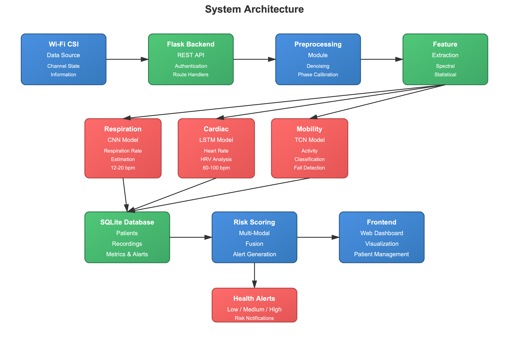

# HealthMonitor - Non-Contact Multi-Model Health Monitoring System


A comprehensive health monitoring system using Wi-Fi Channel State Information (CSI) technology for non-contact vital signs detection.

## 🌟 Features

- **Non-Contact Monitoring**: Monitor vital signs without any wearable devices
- **Real-time Analysis**: Process CSI data and extract health metrics instantly
- **Patient Management**: Complete CRUD operations for patient records
- **Health Metrics**: Track heart rate, respiration rate, HRV, and activity levels
- **Risk Assessment**: Automated risk scoring and alert generation
- **Modern UI**: Professional, responsive web interface
- **RESTful API**: Complete API for integration with other systems

## 🚀 Quick Start

### Prerequisites

- Python 3.8 or higher
- pip (Python package manager)

### Installation

1. **Clone the repository**
```bash
git clone https://github.com/AtharwaKatkar/health-monitoring-system.git
cd health-monitoring-system
```

2. **Install dependencies**
```bash
pip install -r requirements.txt
```

3. **Run the application**
```bash
python unified_app.py
```

4. **Access the application**
Open your browser and navigate to: `http://localhost:5000`

## 📊 System Architecture

```
┌─────────────────────────────────────────────────────────┐
│                    Web Interface                         │
│              (Modern Responsive UI)                      │
└─────────────────────┬───────────────────────────────────┘
                      │
┌─────────────────────▼───────────────────────────────────┐
│                 Flask Backend                            │
│  ┌──────────────┬──────────────┬──────────────────┐    │
│  │   Patient    │  Recording   │    Health        │    │
│  │  Management  │   Upload     │   Monitoring     │    │
│  └──────────────┴──────────────┴──────────────────┘    │
└─────────────────────┬───────────────────────────────────┘
                      │
┌─────────────────────▼───────────────────────────────────┐
│              Processing Pipeline                         │
│  ┌──────────────┬──────────────┬──────────────────┐    │
│  │   Feature    │      ML      │     Risk         │    │
│  │  Extraction  │   Inference  │   Scoring        │    │
│  └──────────────┴──────────────┴──────────────────┘    │
└─────────────────────┬───────────────────────────────────┘
                      │
┌─────────────────────▼───────────────────────────────────┐
│                SQLite Database                           │
│     (Patients, Recordings, Metrics, Alerts)             │
└─────────────────────────────────────────────────────────┘
```

## 🎯 Key Components

### Frontend
- **Modern UI**: Built with Bootstrap 5 and custom CSS
- **Responsive Design**: Works on desktop, tablet, and mobile
- **Interactive Dashboard**: Real-time metrics visualization
- **Patient Portal**: Easy patient management interface

### Backend API
- **RESTful Endpoints**: Complete API for all operations
- **Authentication**: Token-based authentication
- **Error Handling**: Comprehensive error handling and logging
- **Database**: SQLAlchemy ORM with SQLite

### ML Pipeline
- **Feature Extraction**: Advanced signal processing
- **Health Metrics**: Respiration, cardiac, and mobility analysis
- **Risk Scoring**: Automated health risk assessment
- **Alert Generation**: Real-time health alerts

## 📁 Project Structure

```
health-monitoring-system/
├── backend/                 # Backend application
│   ├── routes/             # API routes
│   ├── models.py           # Database models
│   └── config.py           # Configuration
├── frontend/               # Frontend application
│   ├── templates/          # HTML templates
│   ├── static/            # CSS, JS, images
│   └── uploads/           # Uploaded files
├── ml/                    # Machine learning
│   ├── models.py          # ML model definitions
│   ├── inference.py       # Inference pipeline
│   └── train.py           # Training scripts
├── preprocess/            # Data preprocessing
│   ├── features.py        # Feature extraction
│   ├── denoise.py         # Denoising
│   └── phase_calib.py     # Phase calibration
├── data/                  # Data storage
│   ├── raw/              # Raw CSI data
│   └── synthetic/        # Synthetic data
├── models/               # Trained models
├── unified_app.py        # Main application
├── requirements.txt      # Dependencies
└── README.md            # This file
```

## 🔧 API Endpoints

### Patient Management
- `GET /api/v1/patients` - List all patients
- `POST /api/v1/patients` - Create new patient
- `GET /api/v1/patients/{id}` - Get patient details
- `GET /api/v1/patients/{id}/alerts` - Get patient alerts
- `GET /api/v1/patients/{id}/metrics` - Get patient metrics

### Recording Management
- `GET /api/v1/recordings` - List recordings
- `POST /api/v1/recordings` - Upload recording
- `POST /api/v1/recordings/{id}/process` - Process recording
- `GET /api/v1/recordings/{id}/metrics` - Get recording metrics

### System
- `GET /api/v1/health` - Health check
- `POST /api/demo/run` - Run demo

## 💡 Usage Examples

### Creating a Patient
```python
import requests

data = {
    "name": "John Doe",
    "age": 65,
    "conditions": "Hypertension"
}

response = requests.post(
    "http://localhost:5000/api/v1/patients",
    json=data,
    headers={"Authorization": "Bearer dev-token-123"}
)
```

### Uploading a Recording
```python
files = {'file': open('recording.json', 'rb')}
data = {'patient_id': 1, 'device_id': 'wifi_sensor_01'}

response = requests.post(
    "http://localhost:5000/api/v1/recordings",
    data=data,
    files=files,
    headers={"Authorization": "Bearer dev-token-123"}
)
```

## 🎨 Screenshots

### Dashboard


### Patient Management
Modern interface for managing patient records with real-time health metrics.

### Health Monitoring
Real-time visualization of vital signs and health indicators.

## 🔬 Technology Stack

- **Backend**: Flask, SQLAlchemy, Flask-CORS
- **Frontend**: HTML5, CSS3, JavaScript, Bootstrap 5
- **ML/AI**: PyTorch, NumPy, SciPy, scikit-learn
- **Database**: SQLite
- **Signal Processing**: SciPy, NumPy

## 📈 Health Metrics

The system monitors and analyzes:

- **Respiration Rate**: 12-20 breaths/min (normal range)
- **Heart Rate**: 60-100 BPM (normal range)
- **Heart Rate Variability (HRV)**: Cardiac health indicator
- **Activity Level**: Sitting, standing, walking, fall detection
- **Risk Score**: 0-100 scale with automated alerts

## 🛡️ Security

- Token-based authentication
- Input validation and sanitization
- SQL injection prevention
- XSS protection
- CORS configuration

## 🧪 Testing

Run the comprehensive test suite:

```bash
python test_system.py
```

## 📝 Configuration

Edit `backend/config.py` to customize:

- Database settings
- Upload folder location
- Model directory
- Risk scoring weights
- API token

## 🤝 Contributing

Contributions are welcome! Please feel free to submit a Pull Request.

1. Fork the repository
2. Create your feature branch (`git checkout -b feature/AmazingFeature`)
3. Commit your changes (`git commit -m 'Add some AmazingFeature'`)
4. Push to the branch (`git push origin feature/AmazingFeature`)
5. Open a Pull Request

## 📄 License

This project is licensed under the MIT License - see the LICENSE file for details.

## 👥 Authors

- **Atharwa Katkar** - [GitHub](https://github.com/AtharwaKatkar)

## 🙏 Acknowledgments

- Wi-Fi CSI research community
- Flask and PyTorch communities
- Health monitoring research teams

## 📞 Support

For support, email your-email@example.com or open an issue on GitHub.

## 🔮 Future Enhancements

- [ ] Real-time streaming data support
- [ ] Mobile application
- [ ] Advanced ML models
- [ ] Multi-user authentication
- [ ] Cloud deployment
- [ ] Integration with medical devices
- [ ] Telemedicine features

---

**Note**: This system is for research and educational purposes. It should not be used as a substitute for professional medical advice, diagnosis, or treatment.
